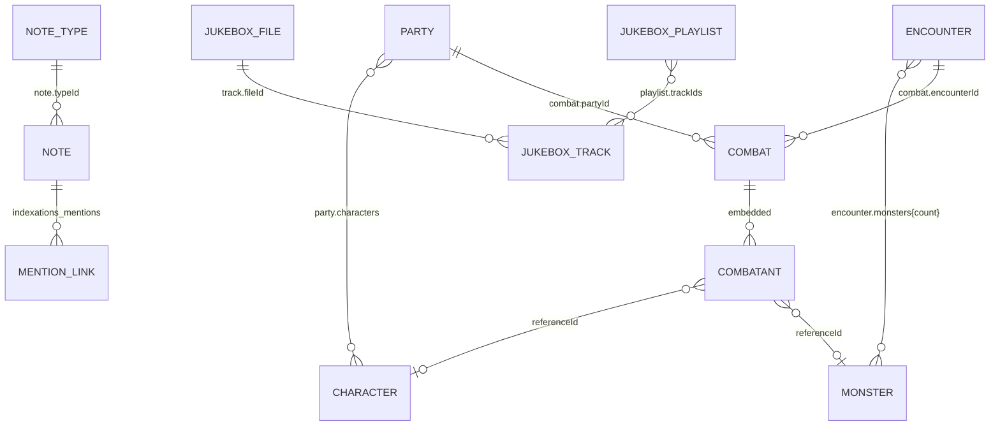

# Data Model

## Conventions

- Every persisted entity extends `WithMetadata`:
  ```ts
  {
    id: string;
    createdAt: number;
    updatedAt: number;
  }
  ```
- IDs are generated with `nanoid(10)` (`utils/storage.ts#generateId`). The
  alphabet includes letters, digits, `_`, and `-`.
- Timestamps are Unix milliseconds from `Date.now()`.
- All records are plain JSON-serializable objects; `deepUnwrap()` converts Vue
  proxies/refs before persistence and explicitly preserves `Blob` and
  `FileSystemFileHandle`.
- Shapes are defined twice: TypeScript interfaces in `src/types/index.ts` and
  JSON Schemas in `src/schemas/*.json`. They are not generated from each other
  and have drifted in places.

## Entities

### Note

| Field         | Type               | Notes                                                        |
| ------------- | ------------------ | ------------------------------------------------------------ |
| `title`       | `string`           | Required by schema and UI                                    |
| `content`     | `string`           | Markdown source, or a Quickdraw JSON snapshot for draw notes |
| `contentType` | `'text' \| 'draw'` | Note content kind; defaults to `text`                        |
| `preview`     | `string?`          | Small PNG data URL preview for drawing notes                 |
| `typeId`      | `string \| null`   | References a `NoteType`; UI for setting it is commented out  |
| `tags`        | `string[]`         | Used for card chips and route-based tag filtering            |
| `parentId`    | `string?`          | Declared in TS, not persisted by schemas/UI                  |
| `metadata`    | `object?`          | Declared in TS, unused                                       |
| `hidden`      | `boolean`          | `true` = document-tree note, excluded from normal note list  |

Schema: `src/schemas/note.schema.json` requires `id`, `title`, `content`,
`typeId`, `tags`, `createdAt`, `updatedAt`. `hidden` is not listed
but is accepted because additional properties are allowed.

**Hidden-note semantics.** A note with `hidden: true` is filtered out of
`NotesView` (`noteStore.filtered.filter(n => !n.hidden)`) and cannot be toggled
after creation because `noteStore.update()` restores the original `hidden`
value (`src/stores/notes.ts`).

### NoteType

| Field                          | Type               | Notes                          |
| ------------------------------ | ------------------ | ------------------------------ |
| `name`                         | `string`           | Required                       |
| `description`, `color`, `icon` | optional           | Rendered by `NoteTypeSelector` |
| `fields`                       | `NoteTypeField[]?` | Declared but never rendered    |

`NoteTypeField` describes `text | number | boolean | date | select |
multiselect` fields with optional options/defaults. No code consumes these
fields. The note editor UI for selecting a type is commented out.

### Party

| Field                  | Type       | Notes         |
| ---------------------- | ---------- | ------------- |
| `name`                 | `string`   | Required      |
| `description`, `notes` | `string?`  | Editor fields |
| `characters`           | `string[]` | Character IDs |

### Character (PlayerCharacter)

| Field   | Type      | Notes     |
| ------- | --------- | --------- |
| `name`  | `string`  | Required  |
| `notes` | `string?` | Free text |

The README advertises stats, equipment, and full character sheets; the actual
type has only name and notes. Older test suites still assume `level`, `class`,
`stats`, `hitPoints`, `armorClass`, etc.

### Monster

| Field   | Type      | Notes     |
| ------- | --------- | --------- |
| `name`  | `string`  | Required  |
| `notes` | `string?` | Free text |

Again, no stat block/CR/HP fields exist.

### Encounter

| Field         | Type                     | Notes                                     |
| ------------- | ------------------------ | ----------------------------------------- |
| `name`        | `string`                 | Required                                  |
| `description` | `string?`                | Rendered with `v-html` in the detail view |
| `monsters`    | `Record<string, number>` | Monster ID → count (schema: 1..20)        |
| `notes`       | `string?`                | Free text                                 |

### Combat

| Field          | Type                                     | Notes                       |
| -------------- | ---------------------------------------- | --------------------------- |
| `encounterId`  | `string`                                 | Reference                   |
| `partyId`      | `string`                                 | Reference                   |
| `status`       | `'preparing' \| 'active' \| 'completed'` | Lifecycle                   |
| `currentRound` | `number`                                 | Starts at 0 while preparing |
| `currentTurn`  | `number`                                 | Index into combatants       |
| `combatants`   | `Combatant[]`                            | Snapshotted participants    |
| `notes`        | `string?`                                | Free text                   |

`Combatant`:

```ts
{
  id: string;                 // unique per participant instance
  name: string;               // REQUIRED by TS, but never populated by creators
  type: 'player' | 'monster';
  referenceId?: string;       // character or monster ID
  notes?: string;
  initiative: number;
  hasActed: boolean;
  isPostponed: boolean;
  createdAt, updatedAt: number;
}
```

The schema does **not** require `name`, and both `PartySelector` and
`CombatView` create combatants without it. Display names are resolved from
`referenceId` at render time, so this mismatch is type-only today but blocks a
clean type check.

### Bookmark

| Field       | Type     | Notes                                                         |
| ----------- | -------- | ------------------------------------------------------------- |
| `noteId`    | `string` | Legacy anchor mirror; matches `anchorId` for note bookmarks   |
| `title`     | `string` | Editable label; created as `''` then resolved from note title |
| `ownerKind` | `string` | Only `note` is supported                                      |
| `ownerId`   | `string` | Owning note ID                                                |
| `anchorId`  | `string` | Bookmarked heading/paragraph anchor                           |

Uniqueness is enforced only in application code
(`findByOwnerAndAnchor`), not by an IndexedDB index.

### Timer

| Field                  | Type                                    | Notes            |
| ---------------------- | --------------------------------------- | ---------------- |
| `title`, `description` | `string?`                               | Optional labels  |
| `duration`             | `number`                                | Milliseconds     |
| `startedAt`            | `number \| null`                        | Wall-clock start |
| `status`               | `'inactive' \| 'running' \| 'finished'` | Lifecycle        |

Schema forbids additional properties. Title/description accept `null` in the
schema but the TS type uses optional strings.

### Jukebox entities

Defined in `src/jukebox/types.ts` and intentionally **not** schema-validated
(FileSystem handles are not plain JSON).

**StoredFile** (`files` store)

```ts
{
  id, name, size, type, lastModified, signature, createdAt, updatedAt,
  source:
    | { kind: 'handle'; handle: FileSystemFileHandle }
    | { kind: 'blob'; blob: Blob }
}
```

Files are deduplicated by the metadata signature
`name | size | lastModified | type`. Business records reference `files.id`.

**JukeboxTrack**

```ts
{
  id, createdAt, updatedAt,
  fileId,
  title, artist?, album?, duration?,
  artworkUrl?, playlistIds, genre?, year?, trackNumber?, discNumber?,
  composer?, comment?, lyrics?,
  picture?: string | Blob,
  color?: string,
  palette?: string[],
  waveform?: string | null,
  disabled?: boolean
}
```

`playlistIds` is declared but membership is actually read from
`playlist.trackIds`; the field is created empty and never maintained.

**JukeboxPlaylist**

```ts
{
  id, createdAt, updatedAt,
  name, description?, trackIds, sortOrder?
}
```

### Map data in locations

Defined in `src/maps/types.ts`; locations are schema-validated
(`src/maps/schemas/mapLocation.schema.json`). Map files are not schema-validated
because they may contain `Blob`/`FileSystemFileHandle` sources. Map data is
embedded in `MapLocation.map`; there is no runtime `MapEntity` store.

**MapImageMetadata** (`map_image_metadata` store)

```ts
{
  id, // references files.id
  imageMetadata: {
    width, height, naturalWidth?, naturalHeight?, aspectRatio,
    fileSize?, mimeType?, color?, palette?
  },
  createdAt, updatedAt
}
```

Map image bytes live in the generic `files` store.

**LocationMap** (`MapLocation.map`)

```ts
{
  fileId, // references files.id
  layers: MapLayer[],
  markers: MapMarker[],
  areas: MapArea[]
}
```

**MapLayer**

```ts
{
  (id, title);
}
```

**MapLocation** (`map_locations` store)

```ts
{
  id,
  name,
  description?,
  entities: MapEntityRef[],
  map: LocationMap
}
```

**MapMarker**

```ts
{
  id,
  title,
  description?,
  x, y, // image-pixel coordinates
  locationId?: string | null,
  layerId: string,
  entities: MapEntityRef[],
  icon, // RPG Awesome class without the "ra" prefix
  color, // CSS color
  backgroundColor? // optional badge colour, empty for transparent
}
```

**MapArea**

```ts
{
  id, title, description?,
  shape: 'polygon' | 'circle' | 'square' | 'freehand',
  points: [number, number][],
  center?: [number, number],
  radius?: number,
  locationId?: string | null,
  layerId: string,
  entities: MapEntityRef[],
  icon?: string,
  color
}
```

**MapEntityRef**

```ts
{
  kind: 'note' |
    'party' |
    'monster' |
    'encounter' |
    'character' |
    'map' |
    'location' |
    'playlist';
  id: string;
}
```

## Relationship map



### Mentions index

`indexations_mentions` is a separate object store keyed by `"kind:id"`. Each
record is `{ id: 'note:abc', links: [{kind, id}, ...] }`. `getBacklinks` scans
all records. Only note content is indexed (`noteStore.create/update/remove`);
other entity types are never written to the index, so "mentions" sidebars can
currently only show note→entity and note→note connections.

## Referential integrity

There are no foreign keys, cascade rules, or cleanup routines. Consequences:

- Deleting a character leaves it in `party.characters`; `PartyView` filters via
  `characterStore`, so it disappears from the list but the ID remains and is
  re-saved on the next party update.
- Deleting a monster leaves its key in `encounter.monsters`; the encounter
  table simply does not render it, but the count is still exported.
- Deleting a track removes its file record even if another track references the
  same `fileId`.

## Schema/Type drift

| Area                                         | TS               | JSON Schema      | Effect                           |
| -------------------------------------------- | ---------------- | ---------------- | -------------------------------- |
| `Note.hidden`                                | required boolean | absent           | accepted, not validated          |
| `NoteType.description/color/icon/fields`     | present          | absent           | same                             |
| `Encounter.notes`, `Party.description/notes` | present          | absent           | same                             |
| `Combatant.name`                             | required         | absent           | creators omit it                 |
| `Timer.title/description`                    | optional string  | `string \| null` | nulls pass validation but not TS |
| Bookmarks noteId                             | string           | string           | semantic ambiguity, not drift    |

Because schemas are only applied on **write**, legacy or imported records that
were written before a schema change are not re-validated on load.
