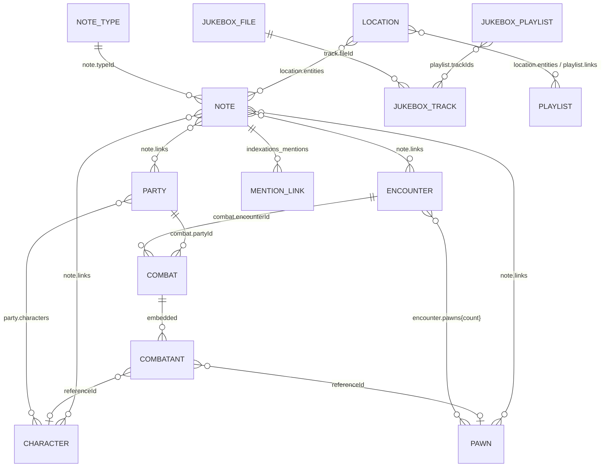

# Data Model

## Conventions

- Every persisted entity extends `WithMetadata`:
  ```ts
  {
    id: string;
    createdAt: number;
    updatedAt: number;
  }
  ```
- IDs are generated with `nanoid(10)` (`utils/storage.ts#generateId`). The
  alphabet includes letters, digits, `_`, and `-`.
- Timestamps are Unix milliseconds from `Date.now()`.
- Most records are plain JSON-serializable objects; `deepUnwrap()` converts Vue
  proxies/refs before persistence and explicitly preserves `Blob` and
  `FileSystemFileHandle`. File-backed records (`files`, jukebox, maps) may
  therefore contain non-JSON sources and are the reason backup has a binary
  encoding.
- Shapes are defined twice: TypeScript interfaces in `src/types/index.ts` and
  JSON Schemas in `src/schemas/*.json`. They are not generated from each other
  and have drifted in places.

## Entities

### Note

| Field      | Type             | Notes                                                         |
| ---------- | ---------------- | ------------------------------------------------------------- |
| `title`    | `string`         | May be empty when the note has content                        |
| `content`  | `string`         | Markdown source; drawings are embedded as `drawing://` blocks |
| `typeId`   | `string \| null` | References a `NoteType`; edited from `NoteOptions`            |
| `tags`     | `string[]`       | Used for card chips and route-based tag filtering             |
| `links`    | `NoteLink[]?`    | Parties, pawns, encounters and characters                     |
| `parentId` | `string?`        | Declared in TS, not written by the current UI                 |
| `metadata` | `object?`        | Declared in TS, unused                                        |

Schema: `src/schemas/note.schema.json` requires `id`, `title`, `content`,
`typeId`, `tags`, `createdAt`, `updatedAt`; `links` is optional.

`NoteLink`:

```ts
{
  kind: 'party' | 'pawn' | 'encounter' | 'character';
  id: string;
}
```

Location links are **not** stored in `note.links`; the relationship helper
writes them to the location's `entities` array instead. See "Link storage"
below.

### Drawing

| Field      | Type     | Notes                              |
| ---------- | -------- | ---------------------------------- |
| `snapshot` | `string` | Quickdraw JSON snapshot            |
| `preview`  | `string` | PNG data URL rendered in documents |

Drawing blocks in notes store a stable `drawing://<id>` image URL in Markdown;
the block caption is serialized as the Markdown image title. Deleting a drawing
block removes both the node and the `drawings` record.

### NoteType

| Field                          | Type               | Notes                          |
| ------------------------------ | ------------------ | ------------------------------ |
| `name`                         | `string`           | Required                       |
| `description`, `color`, `icon` | optional           | Rendered by `NoteTypeSelector` |
| `fields`                       | `NoteTypeField[]?` | Declared but never rendered    |

`NoteTypeField` describes `text | number | boolean | date | select |
multiselect` fields with optional options/defaults. No UI consumes these fields;
`NoteTypeSelector` creates note types with an empty `fields` array. The note type
itself is selectable from `NoteOptions`.

### Party

| Field         | Type       | Notes         |
| ------------- | ---------- | ------------- |
| `name`        | `string`   | Required      |
| `description` | `string?`  | Editor field  |
| `characters`  | `string[]` | Character IDs |

`description` is not declared in `party.schema.json`; the schema still accepts
it because additional properties are allowed. There is no `notes` field on
`Party` in the current TS type.

### Character (PlayerCharacter)

| Field     | Type      | Notes                           |
| --------- | --------- | ------------------------------- |
| `name`    | `string`  | Required                        |
| `notes`   | `string?` | Markdown free text              |
| `picture` | `string?` | Stored file ID for the portrait |

The current type has no stats, equipment, HP, or class fields. `PlayerCharacter`
is an alias of the shared `Character` interface.

### Pawn

| Field     | Type      | Notes                           |
| --------- | --------- | ------------------------------- |
| `name`    | `string`  | Required                        |
| `notes`   | `string?` | Markdown free text              |
| `picture` | `string?` | Stored file ID for the portrait |

`Pawn` is another alias of `Character`; no stat block/CR/HP fields exist.

### Encounter

| Field         | Type                     | Notes                                     |
| ------------- | ------------------------ | ----------------------------------------- |
| `name`        | `string`                 | Required                                  |
| `description` | `string?`                | Rendered with `v-html` in the detail view |
| `pawns`       | `Record<string, number>` | Pawn ID → pawn count (schema: 1..20)      |

### Combat

| Field          | Type                                     | Notes                       |
| -------------- | ---------------------------------------- | --------------------------- |
| `encounterId`  | `string`                                 | Reference                   |
| `partyId`      | `string`                                 | Reference                   |
| `status`       | `'preparing' \| 'active' \| 'completed'` | Lifecycle                   |
| `currentRound` | `number`                                 | Starts at 0 while preparing |
| `currentTurn`  | `number`                                 | Index into combatants       |
| `combatants`   | `Combatant[]`                            | Snapshotted participants    |
| `notes`        | `string?`                                | Free text                   |

`Combatant`:

```ts
{
  id: string;                 // unique per participant instance
  type: 'player' | 'pawn';
  referenceId?: string;       // character or pawn ID
  notes?: string;
  initiative: number;
  hasActed: boolean;
  isPostponed: boolean;
  isExcluded?: boolean;       // stays listed, skipped in turn handling
  createdAt, updatedAt: number;
}
```

There is no `name` field. `PartySelector` and `CombatView` create combatants
without one, and display names are resolved from `referenceId` at render time.
The JSON schema only requires `id`, `type`, and `initiative` and does not list
`hasActed`, `isPostponed`, or `isExcluded`, but additional properties are
accepted on write.

### Bookmark

| Field       | Type      | Notes                                                       |
| ----------- | --------- | ----------------------------------------------------------- |
| `noteId`    | `string`  | Legacy anchor mirror; matches `anchorId` for note bookmarks |
| `title`     | `string`  | Label captured from the heading at bookmark time            |
| `ownerKind` | `'note'?` | Only `note` is supported                                    |
| `ownerId`   | `string?` | Owning note ID                                              |
| `anchorId`  | `string?` | Bookmarked heading/paragraph anchor                         |

The TS type marks `ownerKind`, `ownerId`, and `anchorId` optional; the store
defaults missing values to `note`, `''`, and `noteId` respectively. Uniqueness
is enforced only in application code (`findByOwnerAndAnchor`), not by an
IndexedDB index.

### Timer

| Field                  | Type                                    | Notes            |
| ---------------------- | --------------------------------------- | ---------------- |
| `title`, `description` | `string?`                               | Optional labels  |
| `duration`             | `number`                                | Milliseconds     |
| `startedAt`            | `number \| null`                        | Wall-clock start |
| `status`               | `'inactive' \| 'running' \| 'finished'` | Lifecycle        |

Schema forbids additional properties. Title/description accept `null` in the
schema but the TS type uses optional strings.

### Jukebox entities

Defined in `src/jukebox/types.ts` and intentionally **not** schema-validated
(FileSystem handles are not plain JSON).

**StoredFile** (`files` store)

```ts
{
  id, name, size, type, lastModified, signature, createdAt, updatedAt,
  contentHash?, // optional SHA-256
  source:
    | { kind: 'handle'; handle: FileSystemFileHandle }
    | { kind: 'blob'; blob: Blob }
    | { kind: 'opfs'; path: string }
}
```

Files are deduplicated by the metadata signature
`name | size | lastModified | type`; `contentHash` is optional. Business records
reference `files.id`. Large blob-backed files can be promoted to OPFS by the map
and settings flows.

**JukeboxTrack**

```ts
{
  id, createdAt, updatedAt,
  fileId,
  title, artist?, album?, duration?,
  artworkUrl?, playlistIds, genre?, year?, trackNumber?, discNumber?,
  composer?, comment?, lyrics?,
  picture?: string | Blob,
  color?: string,
  palette?: string[],
  waveform?: string | null,
  disabled?: boolean
}
```

`playlistIds` is declared but membership is actually read from
`playlist.trackIds`; the field is created empty and never maintained.

**JukeboxPlaylist**

```ts
{
  id, createdAt, updatedAt,
  name, description?, trackIds, sortOrder?,
  links?: MapEntityRef[]
}
```

`links` is persisted by the shared relation helper when a playlist is linked to
locations, pawns, encounters, or parties. Playlists are also offered as a link
target from map locations.

### Map data in locations

Defined in `src/maps/types.ts`; locations are schema-validated
(`src/maps/schemas/mapLocation.schema.json`). Map files are not schema-validated
because they may contain `Blob`/`FileSystemFileHandle` sources. Map data is
embedded in `MapLocation.map`; there is no runtime `MapEntity` store.

**MapImageMetadata** (`map_image_metadata` store)

```ts
{
  id, // references files.id
  imageMetadata: {
    width, height, naturalWidth?, naturalHeight?, aspectRatio,
    fileSize?, mimeType?, color?, palette?
  },
  createdAt, updatedAt
}
```

Map image bytes live in the generic `files` store.

**LocationMap** (`MapLocation.map`)

```ts
{
  fileId, // references files.id
  layers: MapLayer[],
  markers: MapMarker[],
  areas: MapArea[]
}
```

**MapLayer**

```ts
{
  id: string;
  title: string;
}
```

**MapLocation** (`map_locations` store)

```ts
{
  id,
  name,
  description?,
  entities: MapEntityRef[],
  map: LocationMap
}
```

**MapMarker**

```ts
{
  id,
  title,
  description?,
  x, y, // image-pixel coordinates
  locationId?: string | null,
  layerId: string,
  entities: MapEntityRef[],
  icon, // RPG Awesome class, e.g. "ra-castle"
  color, // CSS color
  backgroundColor? // optional badge colour, empty for transparent
}
```

**MapArea**

```ts
{
  id, title, description?,
  shape: 'polygon' | 'circle' | 'square' | 'freehand',
  points: [number, number][],
  center?: [number, number],
  radius?: number,
  locationId?: string | null,
  layerId: string,
  entities: MapEntityRef[],
  icon?: string,
  color
}
```

**MapEntityRef**

```ts
{
  kind: 'note' |
    'party' |
    'pawn' |
    'encounter' |
    'character' |
    'map' |
    'location' |
    'playlist';
  id: string;
}
```

## Relationship map



### Link storage

Cross-entity links are persisted per owner record rather than in one link table:

| Owner     | Field / store                   | Target kinds                                                |
| --------- | ------------------------------- | ----------------------------------------------------------- |
| Note      | `links: NoteLink[]`             | party, pawn, encounter, character                           |
| Location  | `entities: MapEntityRef[]`      | note, party, pawn, encounter, character, location, playlist |
| Playlist  | `links: MapEntityRef[]`         | location, pawn, encounter, party                            |
| Party     | `characters: string[]`          | character                                                   |
| Encounter | `pawns: Record<string, number>` | pawn with count                                             |

`useEntityLinkRelations()` reads and writes these fields depending on the pair
of kinds. Note→location links are written to the location's `entities` array;
location→note links are read from there as well. This means the link is not
necessarily stored on the entity from which the user opened the link dialog.

### Mentions index

`indexations_mentions` is a separate object store keyed by `"kind:id"`. Each
record is `{ id: 'note:abc', links: [{kind, id}, ...] }`. `getBacklinks` scans
all records. Only note content is indexed (`noteStore.create/update/remove`), and
the extractor recognizes `note:`, `party:`, `pawn:`, `encounter:`, and
`location:` links. Other entity types are never written to the index, and
playlists are not extracted. "Mentions" sidebars therefore combine note mentions
with note backlinks; they cannot show entity→entity mentions.

## Referential integrity

There are no foreign keys, cascade rules, or general cleanup routines.
Consequences:

- Deleting a character leaves its ID in `party.characters`, note `links`, and
  location `entities`; views filter missing entities, but the IDs remain and can
  be re-saved on the next update.
- Deleting a pawn leaves its key in `encounter.pawns` and in note/location links;
  the encounter table simply does not render it.
- Deleting a track removes it from playlists and then calls
  `deleteFileIfUnreferenced`. The shared file provider registry checks tracks,
  map locations, character portraits, and pawn portraits before deleting a
  `files` record.
- Deleting a location detaches markers/areas in other locations that point at
  it and deletes the map file only when no provider references it.

## Schema/Type drift

| Area                                        | TS                | JSON Schema                  | Effect                                                           |
| ------------------------------------------- | ----------------- | ---------------------------- | ---------------------------------------------------------------- |
| `NoteType.description/color/icon/fields`    | present           | absent                       | accepted as additional properties                                |
| `Party.description`                         | present           | absent                       | accepted as additional properties                                |
| `Note.parentId`, `Note.metadata`            | present           | absent                       | accepted, but not written by the UI                              |
| `Combatant.hasActed/isPostponed/isExcluded` | present           | absent                       | accepted as additional properties                                |
| `Timer.title/description`                   | optional string   | `string \| null`             | nulls pass validation but not TS                                 |
| `MapEntityRef.kind`                         | excludes `module` | enum still includes `module` | legacy values are accepted by validation, migration removes them |

Because schemas are only applied on **write**, legacy or imported records that
were written before a schema change are not re-validated on load.
