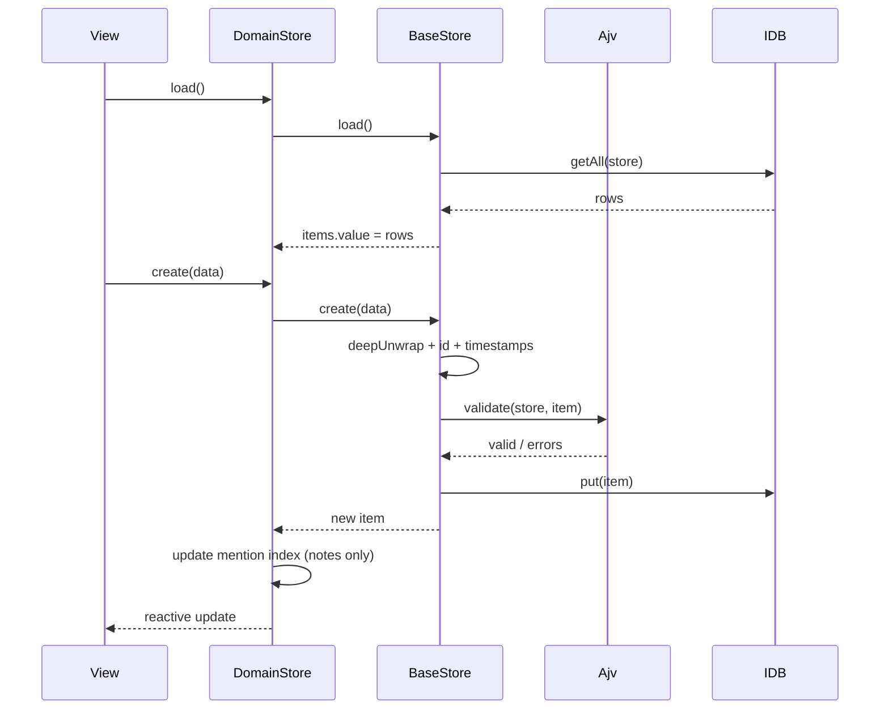

# Persistence and State Management

This part covers the storage engine, the base store, the Pinia domain stores,
schema validation, migrations, and backup/restore. It is the most load-bearing
subsystem in the app: every feature goes through it.

## 1. IndexedDB

**Database:** `dmh-db` (`src/utils/storage.ts`).

Object stores are created lazily by migrations. Current stores:

| Store                  | Owner               | Schema-validated          |
| ---------------------- | ------------------- | ------------------------- |
| `characters`           | `stores/characters` | `character.schema.json`   |
| `monsters`             | `stores/monsters`   | `monster.schema.json`     |
| `notes`                | `stores/notes`      | `note.schema.json`        |
| `noteTypes`            | `stores/noteTypes`  | `noteType.schema.json`    |
| `parties`              | `stores/parties`    | `party.schema.json`       |
| `encounters`           | `stores/encounters` | `encounter.schema.json`   |
| `combats`              | `stores/combats`    | `combat.schema.json`      |
| `drawings`             | `drawings` helpers  | `drawing.schema.json`     |
| `bookmarks`            | `stores/bookmarks`  | `bookmark.schema.json`    |
| `timers`               | `stores/timers`     | `timer.schema.json`       |
| `indexations_mentions` | `useMentionsStore`  | no                        |
| `jukebox_playlists`    | `jukebox/stores`    | no (explicitly bypassed)  |
| `jukebox_tracks`       | `jukebox/stores`    | no                        |
| `files`                | `utils/files`       | no                        |
| `map_image_metadata`   | `maps/maps`         | no                        |
| `sound_packs`          | `ambient-sound`     | no (excluded from backup) |
| `migrations`           | migration runner    | no                        |

All stores use `keyPath: 'id'` with `autoIncrement: false`; the application
generates IDs. Version 17 removes encounter notes; version 16 strips escaped
spaces before block-anchor comments; version 15 removes note content types,
converting legacy drawing notes into drawing blocks; version 14 adds the
`drawings` store; version 13 dropped the removed `modules` store and its
indexes; version 12 added query indexes (`updatedAt`, `typeId`, tags, statuses)
and the `sound_packs` store. `sound_packs` is not in `MAIN_STORE_NAMES`, so
backup/restore leaves ambient audio out while campaign data stays portable.

### Connection helper

`openDB()` returns a singleton `DmhDatabase extends Dexie` for `dmh-db`.
The database is declared at the maximum migration version, with the same store
names and `keyPath: 'id'` that the legacy `idb` database used. That lets Dexie
open existing databases in place instead of requiring an export/import step.

On open, `applyPendingMigrations()`:

1. Reads applied migration records from `migrations`.
2. Selects migrations whose version is not recorded.
3. Runs each migration in a Dexie read/write transaction over its
   `affectedStores` plus `migrations`.
4. Adapts the Dexie transaction to the small object-store interface used by
   migration code, then records the applied migration (`id`, `version`, `name`,
   `appliedAt`).

Migrations run after Dexie's schema is available, so they can use normal
transactions and `await` safely. Schema-only migrations are no-ops; data
migrations keep their historical transform logic.

### Low-level helpers

Dexie-backed helpers keep their historical names so existing call sites and
docs remain stable:

- `idbGetItem(store, id)`
- `idbPutItem(store, item)` — validates first if a schema is registered.
- `idbDeleteItem(store, id)`
- `idbGetAllItems(store)`
- `clearStore(store)` — clears the Dexie table.

`idbPutItem` throws `StorageError` when Ajv reports errors. No view catches
these specifically; they surface as rejected promises.

## 2. Schema validation

`src/utils/schemaValidator.ts` wraps Ajv (`allErrors: true`).

```
registerValidationSchema(name, schema)  → ajv.addSchema(schema, name)
canValidate(name)                       → ajv.getSchema(name) !== undefined
validateSchema(name, data)              → { valid, errors[] }
validateArray(name, data)               → all items valid
getValidationErrors / getArrayValidationErrors
```

Stores register their schema by passing it to `useStore`; the store name is the
schema key. Validation happens in `idbPutItem`, i.e. on every `create` and
`update`. Consequences:

- `load()` does not validate; malformed legacy data is accepted into memory.
- Jukebox stores deliberately pass `validationSchema: undefined`.
- Direct imports (`restoreAllStores` uses `idbPutItem`) need special attention:
  restore writes through a batch and bypasses per-record validation.
- Ajv is configured without `strict: false` or formats; date-like strings are
  just strings.

## 3. Base store

`useStore<T>({ storeName, validationSchema })` returns a cached object
(`storeCache` keyed by store name) with:

| Member                         | Type                        | Behavior                                                              |
| ------------------------------ | --------------------------- | --------------------------------------------------------------------- |
| `items`                        | `Ref<T[]>`                  | Full in-memory list                                                   |
| `isLoaded`                     | `Ref<boolean>`              | Set after first successful load                                       |
| `error`                        | `Ref<Error \| null>`        | Last load error                                                       |
| `sortedItems`                  | `ComputedRef<T[]>`          | Copy sorted by `updatedAt` desc                                       |
| `getById`                      | `(id) => T \| null`         | Linear scan                                                           |
| `create`                       | `(data) => Promise<T>`      | Deep-unwraps, adds ID/timestamps, validates, persists, pushes         |
| `update`                       | `(id, patch) => Promise<T>` | Merges plain original + patch, bumps `updatedAt`, validates, persists |
| `remove`                       | `(id) => Promise<void>`     | Deletes from IDB and memory, clears current if matching               |
| `load`                         | `() => Promise<void>`       | Replaces `items` with `getAll()`                                      |
| `current`                      | `ComputedRef<T \| null>`    | Based on internal `currentId`                                         |
| `setCurrentId`, `clearCurrent` | functions                   | Selection helpers                                                     |

Important consequences:

- `load()` **replaces** the array, discarding unsaved UI-only changes.
- `update()` requires the item to already exist in memory (`Item not found`).
- `current` is rarely used by views; they resolve items from route params
  instead.
- Because the object is cached per store name, two Pinia stores that call
  `useStore('notes')` share the same refs. This is intentional and also why
  Pinia `$reset` cannot fully reset underlying storage.

## 4. Pinia domain stores

All domain stores are **setup stores** that wrap a base store and add
domain-specific state/helpers, then spread the base store:

```ts
export const useNoteStore = defineStore('notes', () => {
  const base = useStore<Note>({ storeName: 'notes', validationSchema: noteSchema });
  ...
  return { ...base, filtered, create, update, remove, ... };
});
```

| Store               | ID           | Extra behavior                                                                                |
| ------------------- | ------------ | --------------------------------------------------------------------------------------------- |
| `useNoteStore`      | `notes`      | Search/tag filter, `allTags`, mention index sync on create/update/remove                      |
| `useCharacterStore` | `characters` | Name search                                                                                   |
| `useMonsterStore`   | `monsters`   | Name search                                                                                   |
| `usePartyStore`     | `parties`    | Name search                                                                                   |
| `useEncounterStore` | `encounters` | Name search                                                                                   |
| `useCombatStore`    | `combats`    | Combatant/turn helpers, `startCombat`, `endCombat`, `resetCombat`, `nextTurn`, `previousTurn` |
| `useNoteTypeStore`  | `noteTypes`  | Name search                                                                                   |
| `useBookmarkStore`  | `bookmarks`  | `findByNoteAndAnchor`, `isBookmarked`, `addBookmark`, `removeBookmark`                        |
| `useTimerStore`     | `timers`     | `init`, `start/stop/reset`, ticking `now` ref, completion notifications                       |

### Filtering

Every list store exposes `filtered`, `setFilter`, `clearFilter`,
`setSearchQuery`, and `searchQuery`. `BaseListView` forwards search props to
`ViewHeader`, and the searchable list views bind them to their domain store;
`NotesView` additionally supports the URL tag filter.

### Mention indexing (notes store)

`noteStore.create/update` call `extractMentionedEntities(content)` and
`indexation.setLinks({kind:'note', id}, mentions)`. `remove` calls
`clearLinks`. The index is the only cross-entity relationship that is
maintained automatically.

### Timer store

The timer store is special:

- `init()` loads timers and starts `checkFinishedTimers()` exactly once per
  module lifetime (`counter` flag).
- `checkFinishedTimers` updates `nowRef`, walks all timers, marks expired ones
  `finished`, shows a Quasar `Notify` toast, then schedules itself again after
  1 second. **It keeps polling even when no timer is running**, and the timeout
  is never cleared.
- `start` sets `startedAt = Date.now()` and `status = 'running'`.
- `stop` clears `startedAt` and sets `inactive` (elapsed time is discarded).
- `reset` is an alias for `start`.

The global tick is consumed by `App.vue` (animated clock icon) and
`TimerListItem` (countdown display).

## 5. Configuration store

`src/utils/configStore.ts` is a Pinia store with **manual localStorage
persistence** rather than `pinia-plugin-persistedstate`.

- Keys are prefixed `dmh-config:`.
- `getValue` JSON-parses; invalid JSON throws during store creation.
- A `watch` per key writes changes back.
- Values: `jukeboxLastTrackId`, `jukeboxLastPlaylistId`,
  `jukeboxLastTrackProgress`,
  `jukeboxLastVolume`, `jukeboxActivePlaylistId`, `jukeboxRepeatMode`,
  `jukeboxShuffle`, `jukeboxSmoothTrackChange`,
  `jukeboxAnimatePlayerBackground`, `jukeboxDisplayCoverWhilePlaying`,
  `jukeboxUseMiniPlayer`, `confirmDelete`, `savedLanguage`, `uiTheme`.
- `savedLanguage` defaults to `window.navigator.language`.
- `uiTheme` defaults to `light` and accepts `light`, `dark` or `auto`.

### UI theme

`uiTheme` is applied by `src/main.ts` through Quasar’s **Dark plugin**:

- `light` → `Dark.set(false)`;
- `dark` → `Dark.set(true)`;
- `auto` → `Dark.set('auto')`, which follows `prefers-color-scheme`.

`src/composables/useUiTheme.ts` exposes a reactive `isDark` value for parts
that need the resolved theme, such as the Monaco editor (`vs` / `vs-dark`).
Custom surfaces use `body.body--dark` overrides in
`src/assets/styles/global.css`; Quasar components switch automatically.
`index.html` reads the saved theme before the app boots to avoid a light flash.

`pinia-shared-state` is also active for serializable stores, so they are
synchronized between tabs when the browser supports it. There is no conflict
resolution beyond last-write-wins. The `ambient-sound`, `jukeboxPlayer` and `pictureUrlCache` stores opt out of
sharing: their runtime state contains `Map`/`Set` values, playback queues,
artwork `Blob`s and object URLs that cannot be serialized safely. Sharing them
previously replaced live maps with plain objects and corrupted track artwork.

## 6. Migrations

Types in `src/types/migration.ts`:

```ts
interface Migration {
  version: number;
  name: string;
  affectedStores: string[];
  go(transaction): Promise<void>;
}
```

Current migrations:

| Version | File                           | Effect                                |
| ------- | ------------------------------ | ------------------------------------- |
| 1       | `0000000001_initial_schema.ts` | Declares all core stores (no-op `go`) |
| 2       | `0000000002_bookmarks.ts`      | Adds `bookmarks`                      |
| 3       | `0000000003_timers.ts`         | Adds `timers`                         |

Sorted in `src/migrations/index.ts`. The database version is the maximum of the
migration versions and `SCHEMA_VERSION` (17, which removes encounter notes).
Adding a migration requires adding it to the `migrations`
array; new stores are also fed into the Dexie schema through
`affectedStores`. Indexes require updating `EXPLICIT_SCHEMA`.

Migrations 1–4 are schema-only. Migrations 5–9 and 11–17 also transform or
create data/stores (map locations, layers, note content type, legacy files,
removing module links and the note `hidden` flag, the drawings store, the
removal of note content types, block-anchor cleanup, and encounter notes).

## 7. Backup and restore

`backupAllStores()` zips each store in `MAIN_STORE_NAMES` as
`<store>.json` (pretty-printed array).

`MAIN_STORE_NAMES` lists the campaign stores included in a backup:
`characters, combats, drawings, encounters, monsters, notes, noteTypes,
parties, map_locations, bookmarks, timers, jukebox_playlists, jukebox_tracks,
files, map_image_metadata, indexations_mentions`.

It deliberately excludes `sound_packs`, so ambient audio packs do not bloat
campaign backups, and the legacy `maps` / `map_files` / `jukebox_files` stores,
which are no longer written.

Backup encoding (v2):

- `manifest.json` records the format, version and store list.
- Normal records are written as JSON.
- `files.json` holds StoredFile metadata.
- Blob and OPFS file bytes are written as binary `files/<fileId>` ZIP entries.
- FileSystem handles cannot be serialized; they are written as
  `source.kind: 'unavailable'` and may need relinking after restore. With
  `includeExternalFiles: true`, readable handles are copied into the archive
  instead.
- Restoring writes binary entries back to OPFS when available and falls back to
  IDB Blobs.
- Restoring an older backup still converts `jukebox_files` / `map_files`
  entries and legacy `blob-data` sources into the generic file store.

`restoreAllStores(blob)` iterates the same list, clears each store, and writes
items one by one with validation. Restore is not a single cross-store
transaction; an invalid item can leave a partially cleared database.
HomeView reloads the page after a successful restore so every store, timer,
bookmark, jukebox record, and mention index is refreshed.

## 8. State-flow summary



## 9. Known persistence limitations

- No transactions across multiple stores for domain operations.
- No referential integrity or cascade cleanup.
- No optimistic conflict handling between tabs; `pinia-shared-state` replaces
  whole store state, which can overwrite in-flight edits.
- `load()` races can overwrite newer in-memory state if two views load the
  same store concurrently (the last `getAll` wins).
- IndexedDB quota errors are not surfaced to the user.
- Backup format is not versioned and has no manifest/checksum.

See [proposals/technical-proposals.md](../proposals/technical-proposals.md)
for a repository/unit-of-work proposal.
