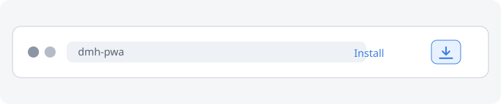

# Install the app

Installing Owlbear's DMH as an app gives it a standalone window and helps the
browser treat the campaign data as important.

## Chrome and Edge on desktop

1. Open Owlbear's DMH in Chrome or Edge.
2. Look for the install icon in the address bar. It usually looks like a small
   monitor with a downward arrow.
3. If the icon is not visible, open the browser menu and choose:
   - **Chrome:** Cast, save, and share → Install page as app.
   - **Edge:** Apps → Install this site as an app.
4. Confirm the installation.

## Chrome and Edge on Android

Open the browser menu and choose **Install app** or **Add to Home screen**.

## Firefox

Firefox desktop does not provide full PWA installation. Keep the app in a
bookmark and use a dedicated window. On Firefox for Android, open the menu and
choose **Add to Home screen**.

## Safari

- **iPhone and iPad:** open the Share menu and choose **Add to Home Screen**.
- **macOS:** use **File → Add to Dock** when your Safari version offers it.

## After installing

Open the app from the system launcher, dock or home screen. Then request
persistent storage again from **Settings → Content → Persistent storage**.

If the browser still refuses, see
[Persistent storage](../troubleshooting/persistent-storage.md).
