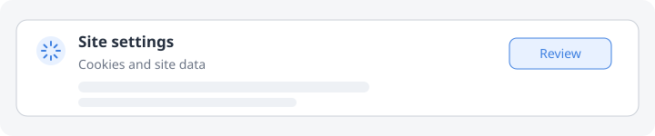

# Persistent storage

Owlbear's DMH stores campaign data locally in the browser. Persistent storage is
a browser hint that the data should not be cleared automatically when the device
is low on space.

The browser decides whether to grant it. It may refuse for a site that is not
installed, has little history, or is in a private window.

## Chrome and Edge

1. [Install the app](../getting-started/install.md) first. Installed apps are
   more likely to be granted persistent storage.
2. Open the site information panel from the icon to the left of the address
   bar and review **Site settings**.
3. Make sure cookies and site data are allowed for this site.
4. Return to **Settings → Content → Persistent storage** and request it again.

Chrome and Edge do not expose a separate “persistent storage” switch. The
browser grants it automatically based on installation and engagement, so
installing the app and using it normally is the reliable path.

## Firefox

Firefox may prompt when a site requests persistent storage. If permission was
blocked, open the site information panel, review the site permissions, and try
again. You can also check the browser's stored site data settings.

## Safari

Safari manages website storage per site. Review the website's storage settings
from the address bar or from Safari settings. On iOS, check
**Settings → Safari → Advanced → Website Data**.

## If it is still denied

- Install the app and open it from the installed entry.
- Use the app normally for a while, then request persistence again.
- Keep a recent backup before clearing browser data or changing site settings.

[Back to installing the app](../getting-started/install.md)
