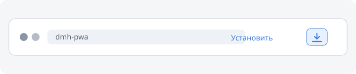

# Установка приложения

Установка Owlbear's DMH как приложения даёт отдельное окно и помогает браузеру
считать данные кампании важными.

## Chrome и Edge на компьютере

1. Откройте Owlbear's DMH в Chrome или Edge.
2. Найдите на адресной строке кнопку установки. Обычно она выглядит как
   небольшой монитор со стрелкой вниз.
3. Если кнопка не видна, откройте меню браузера и выберите:
   - **Chrome:** «Сохранить и поделиться» → «Установить страницу как приложение».
   - **Edge:** «Приложения» → «Установить этот сайт как приложение».
4. Подтвердите установку.

## Chrome и Edge на Android

Откройте меню браузера и выберите **Установить приложение** или
**Добавить на главный экран**.

## Firefox

Firefox для компьютера не поддерживает полноценную установку PWA. Добавьте
приложение в закладки и открывайте его в отдельном окне. В Firefox для Android
откройте меню и выберите **Добавить на главный экран**.

## Safari

- **iPhone и iPad:** откройте меню «Поделиться» и выберите **На экран «Домой»**.
- **macOS:** используйте **Файл → Добавить в Dock**, если эта команда доступна
  в вашей версии Safari.

## После установки

Откройте приложение из системного меню, Dock или с главного экрана. Затем
снова запросите постоянное хранилище в разделе
**Настройки → Данные → Постоянное хранилище**.

Если браузер всё равно отказывает, см.
[Постоянное хранилище](../troubleshooting/persistent-storage.md).
